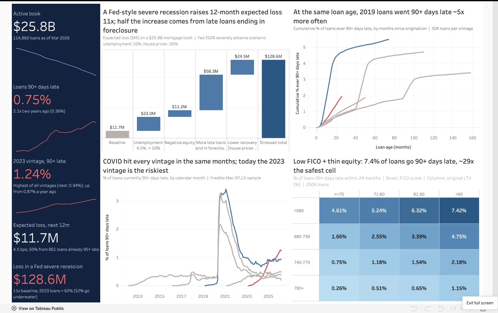
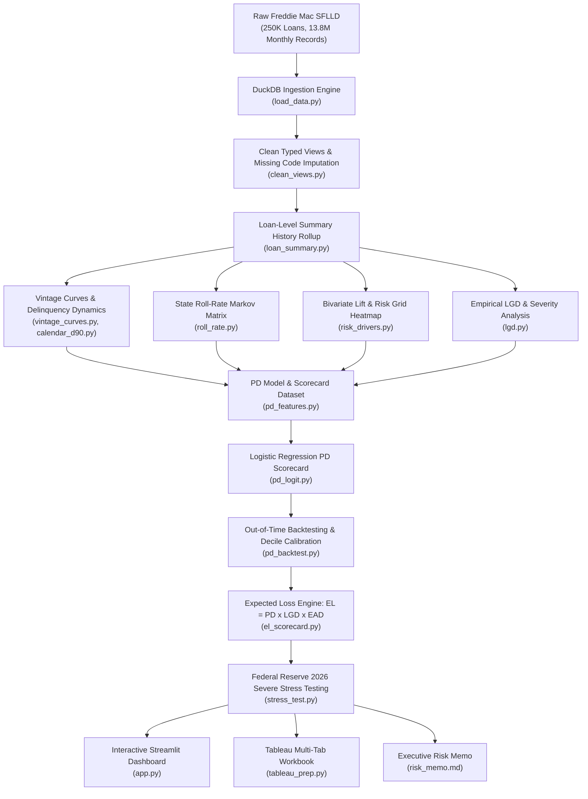
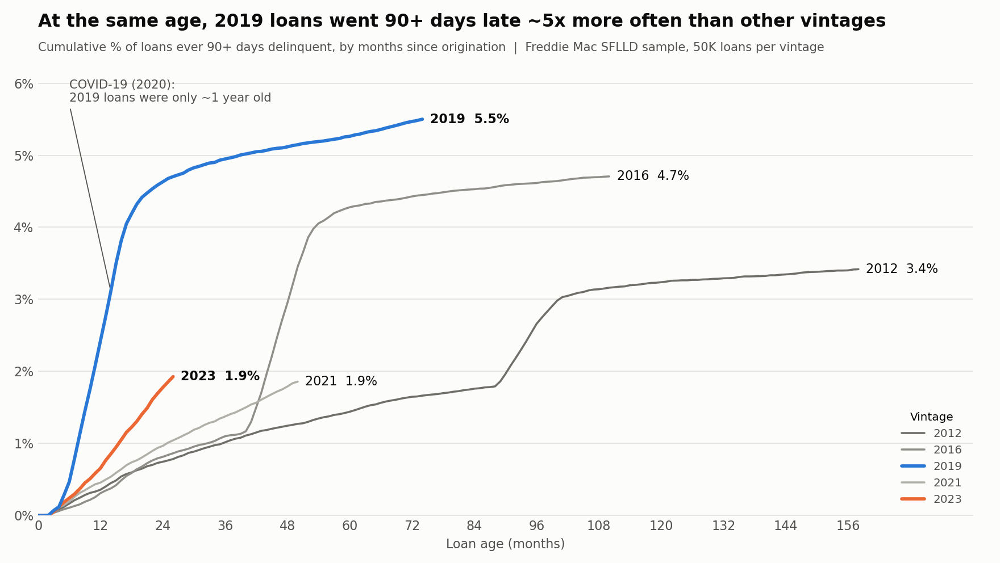
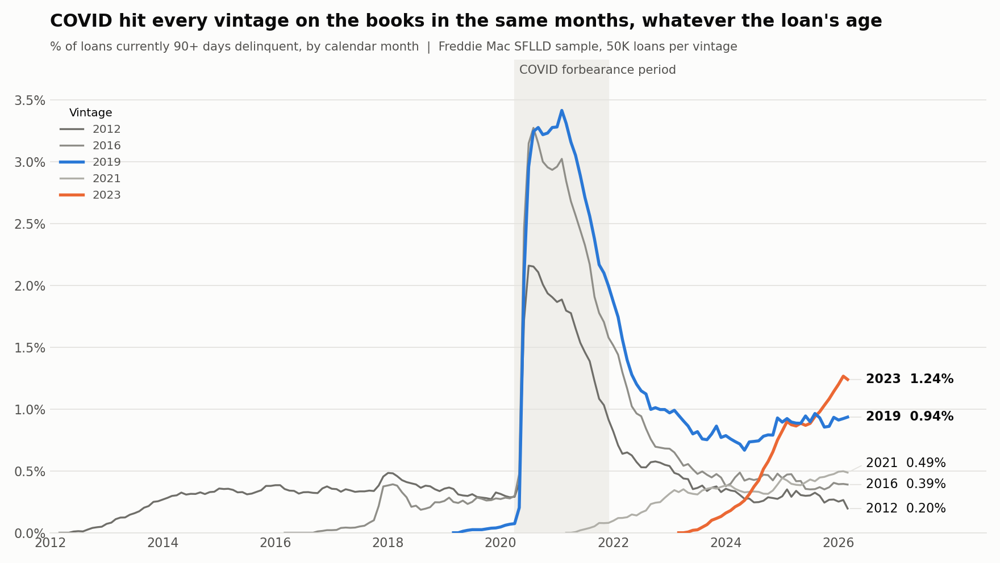
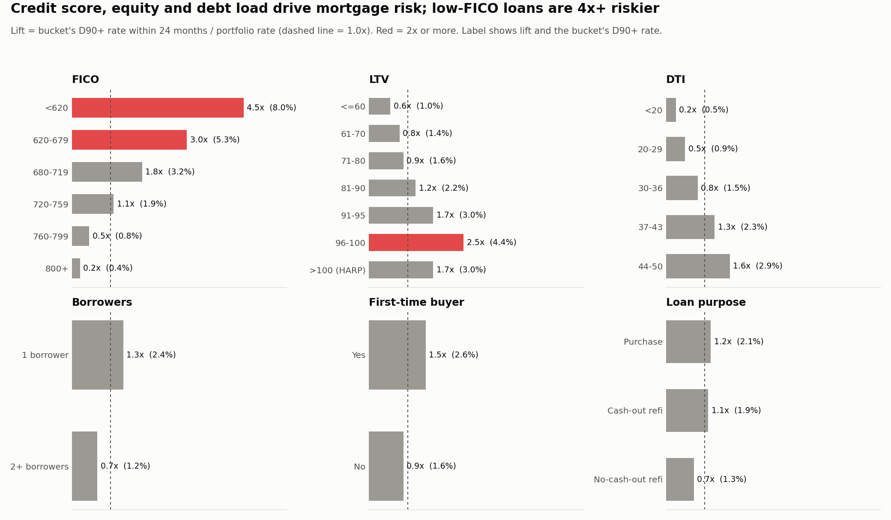
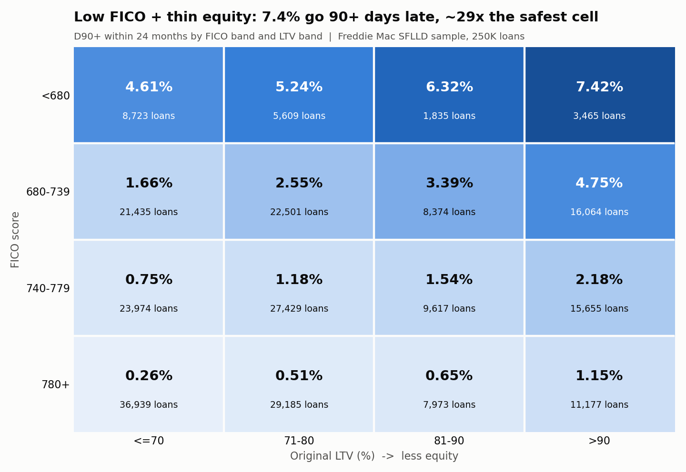
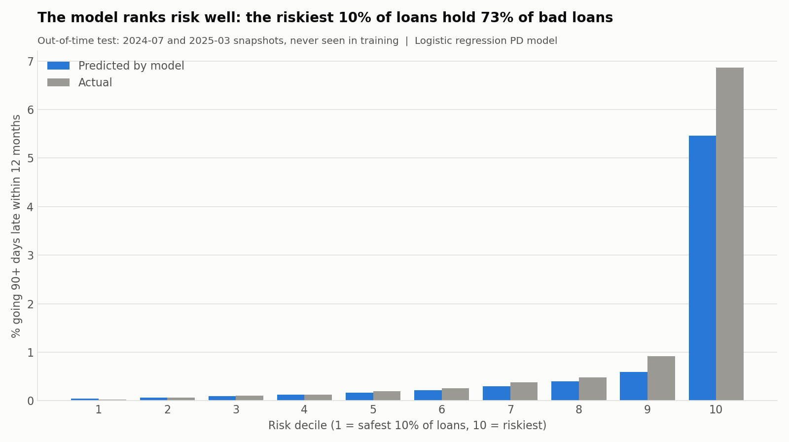
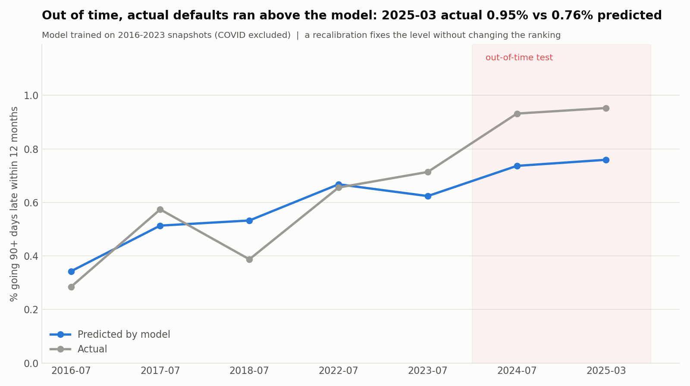
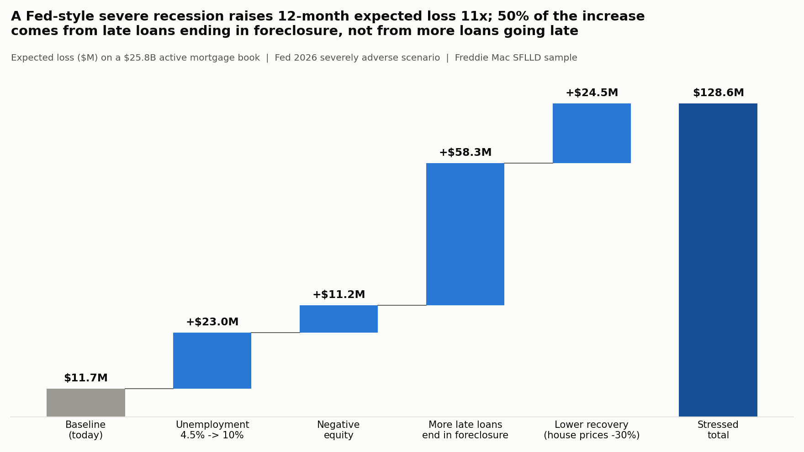
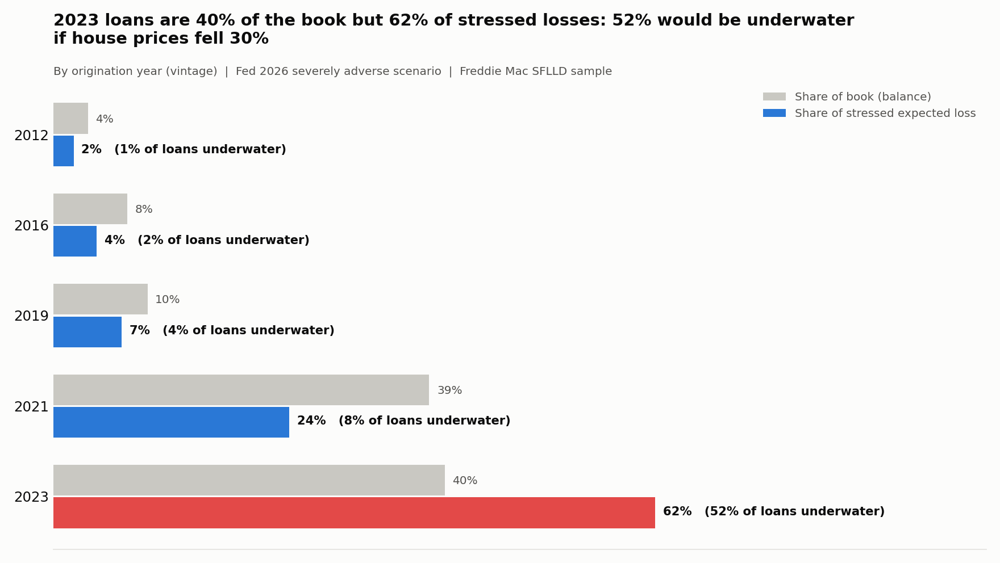

# 🏦 Mortgage Credit Risk Analysis & Macroeconomic Stress Testing Platform

[](https://www.python.org/)
[](https://duckdb.org/)
[](https://streamlit.io/)
[](https://scikit-learn.org/)
[](https://github.com/nmnroy/Mortgage_credit-risk_analysis)
[](http://naman-portfolio.me/Mortgage_credit-risk_analysis/)
[](LICENSE)

An institutional-grade portfolio credit risk analysis of **250,000 Freddie Mac single-family mortgages** ($25.8B balance across 5 origination vintages: 2012, 2016, 2019, 2021, 2023), progressing from raw loan-level performance data to cohort vintage analytics, a regulatory-style **Probability of Default (PD) logistic scorecard** (out-of-time AUC 0.90 / Gini 0.80), a **12-month Expected Loss (EL = PD × LGD × EAD) engine**, and a macroeconomic stress test under the **Federal Reserve's 2026 Severely Adverse Scenario** (-30% home prices, 10% peak unemployment).

🌐 **Live Deployed Portfolio:** **[http://naman-portfolio.me/Mortgage_credit-risk_analysis/](http://naman-portfolio.me/Mortgage_credit-risk_analysis/)**  
📊 **Local Interactive App:** Run `streamlit run app.py` for the local BI platform, or explore the pre-packaged workbook in [`outputs/tableau/tableau_data.xlsx`](outputs/tableau/tableau_data.xlsx).



---

## 🎯 Headline Findings

### ⚠️ The 2023 Vintage is the Primary Vulnerability in the Book
Four independent quantitative methods converge on the **2023 origination vintage** as the core risk concentration:

| Analytical Lens | Finding for 2023 Cohort | Structural Mechanism |
|---|---|---|
| **Vintage Curves** | At 24m seasoning, goes 90+ days delinquent faster than every vintage except 2019 (COVID). | Originated at peak home prices with elevated mortgage rates (6.5%–7.5%). |
| **Calendar View** | Holds the highest share 90+ days late **today**: **1.24%** (up from 0.87% YoY). | Deterioration occurs in a benign macroeconomic baseline, signaling borrower budget exhaustion. |
| **Expected Loss** | Accounts for 40% of active unpaid balance, but **54%–60% of total 12-month expected loss**. | Asymmetric loss contribution requiring targeted provisioning. |
| **Fed Stress Test** | **52% of 2023 loans fall underwater** under a 30% home price decline, generating **62% of stressed losses**. | Negligible equity buffer; highly susceptible to strategic default and loss severity spikes. |

---

## 📊 Key Portfolio Metrics

| Portfolio Metric | Value | Risk & Modeling Context |
|---|---|---|
| **Active Portfolio Balance (Mar 2026)** | **$25.8B** across **114,860 loans** | 79% concentrated in 2021 & 2023 vintages (older books prepaid). |
| **90+ Days Delinquent Rate Today** | **0.75%** | **▲ 2.1x** vs 24 months ago (0.36%), indicating credit cycle turn. |
| **Baseline 12M Expected Loss (PIT)** | **$12.5M** (4.85 bps of balance) | Loan-level scorecard PD; 60% driven by 2023 vintage. |
| **High-Risk Segment Concentration** | **861 loans** already 90+ late | Hold **50%** of baseline expected loss ($6.3M). |
| **Fed Severely Adverse Stressed Loss** | **$128.6M** (49.8 bps) | **▲ 11.0x baseline**; driven by collapse in cure rates. |
| **2-Year Cumulative Stressed Loss** | **$227.6M** (0.88% of balance) | Total 24-month capital reserve requirement. |
| **Loss Given Default (LGD) Severity** | **23.7%** overall | 30.8% in judicial foreclosure states vs 19.6% non-judicial. |
| **Scorecard Discrimination (Out-of-Time)** | **AUC 0.901 / Gini 0.802 / KS 0.644** | Tested on unseen 2024–2025 snapshots (+0.145 AUC vs Segment PD). |

---

## 🏗️ Architecture & Data Pipeline Flow



---

## 🔍 Core Analytical Investigations

### 1. Cohort Vintage Analysis (`vintage_curves.py`, `plot_vintage_curves.py`)
Tracks the cumulative percentage of loans ever reaching 90+ days delinquency as a function of loan seasoning age (months since origination).
- At age 24 months, **2019 loans were 5.2x the median of other cohorts** due to COVID-19 disruption in their second year.
- The **2023 vintage** tracks as the fastest-deteriorating cohort in a normal economic environment.



### 2. Disentangling Vintage vs Calendar Shocks (`calendar_d90.py`)
Plotting delinquency against **calendar month** rather than loan age reveals that every vintage spiked simultaneously between April and September 2020 (portfolio 90+ late rate surged from 0.19% to 2.95%).
- **Conclusion:** COVID-19 was an **exogenous macro shock**, not cohort-level underwriting laxity.



### 3. Delinquency State Transition Dynamics (`roll_rate.py`)
Month-to-month transition probabilities across delinquency states under Normal vs COVID regimes:

| Transition Step | Normal Regime | COVID Regime (Apr 2020 - Dec 2021) | Credit Risk Takeaway |
|---|---|---|---|
| **Current → 30 Days Late** | 1.16% | 4.13% | Borrower inflow to distress tripled. |
| **30 Days Late → 60 Days Late** | 15.5% | 37.7% | Rolling forward accelerated dramatically. |
| **60 Days Late → 90+ Days Late** | 37.1% | 64.1% | Severe roll-through to serious delinquency. |
| **90+ Days Late → Terminal Default** | **1.06%** | **0.09%** | **CARES Act Forbearance & Foreclosure Moratorium** froze terminal liquidation. |

### 4. Bivariate Risk Drivers & Non-Linear Risk Layering (`risk_drivers.py`, `plot_risk_drivers.py`)
"Lift" represents a segment's 24-month delinquency rate divided by the portfolio baseline rate:
- **FICO < 620:** **4.45x** risk lift
- **LTV 96–100:** **2.45x** risk lift
- **DTI 44–50:** **1.65x** risk lift

Across the multi-factor **FICO × LTV matrix**, delinquency expands non-linearly from **0.26%** (FICO 780+, LTV ≤ 70) to **7.42%** (FICO < 680, LTV > 90) — an extreme **29x risk spread**.




### 5. Loss Given Default (LGD) Severity Modeling (`lgd.py`)
Analysis of 485 empirical liquidation events:
- **Baseline Portfolio Severity:** 23.7% of UPB at default.
- **Foreclosure Environment:** **30.8% in judicial foreclosure states** (longer holding periods, legal fees, tax carry) vs **19.6% in non-judicial states**.
- **Credit Enhancement:** Private Mortgage Insurance (PMI) absorbs initial loss, reducing severity from **28.8%** (no MI) to **15.9%** (with MI).
- **Cure vs Foreclosure:** Only **11.8%** of resolved 90+ late loans end in a loss event; the remaining 88.2% cure, refinance, or execute property sales.

### 6. Statistical PD Scorecard Modeling (`pd_features.py`, `pd_logit.py`, `pd_backtest.py`)
A logistic regression credit scorecard developed on 688K loan-snapshot observations using monotonic feature binning:
- **Out-of-Time Validation (2024–2025 unseen snapshots):**
  - **Scorecard PD:** **AUC 0.901 | Gini 0.802 | KS 0.644**
  - **Benchmark Segment PD:** AUC 0.756 | Gini 0.511 | KS 0.394
  - **ML Challenger (HistGradientBoosting):** AUC 0.899 | Gini 0.798 | KS 0.640
- **Key Insight:** Behavior beats origination — past 12-month delinquency carries **~20x odds ratio** compared to clean loans.
- **Discrimination:** The riskiest decile holds **73%–79%** of all realized defaults.




### 7. Expected Loss Engine (`expected_loss.py`, `el_scorecard.py`)
Calculating $EL = PD \times LGD \times EAD$ at loan level:
- Moving from segment PD to loan-level scorecard PD increases 12M EL from $11.7M (4.5 bps) to **$12.5M (4.85 bps)**.
- **Early-Warning Identification:** Isolates **1,432 loans currently 30–60 days late** that carry an average scorecard default probability of **34.9%** (vs 1.9% assigned by naive segment tables). Proactive loss mitigation outreach here saves substantial capital.

### 8. Federal Reserve 2026 Severely Adverse Stress Test (`stress_test.py`, `plot_stress.py`)
Simulating the Fed's Dodd-Frank / CCAR severe recession scenario:
- **Unemployment Shock (4.5% → 10.0%):** Adds +$23.0M
- **Negative Equity Shock (HPI -30% pushes 22,927 loans underwater):** Adds +$11.2M
- **Conversion Shock (Foreclosure cures collapse as equity disappears):** Adds +$58.3M
- **Severity Degradation (Lower recovery on property sales):** Adds +$24.5M
- **Total Stressed Expected Loss:** **$128.6M (49.8 bps)** — an **11.0x amplification**.




---

## 🛠️ Data Analyst Skills Demonstrated

| Technical Competency | Specific Implementation in this Project |
|---|---|
| **Advanced SQL & OLAP Engine** | High-performance queries in **DuckDB**, window functions (`ARG_MAX`), conditional aggregations (`FILTER`), string regex extraction, and table views on 13.8M rows. |
| **Credit Risk Modeling** | Regulatory scorecards, Weight-of-Evidence (WoE) banding, logistic odds ratios, out-of-time (OOT) validation, decile calibration, ROC-AUC, Gini coefficient, and KS statistic. |
| **Financial Risk Frameworks** | Basel II/III Expected Loss ($EL = PD \times LGD \times EAD$), point-in-time (PIT) vs through-the-cycle (TTC) calibration, CECL / IFRS 9 concepts, CCAR / DFAST stress testing. |
| **Data Visualization & BI** | Publication-ready visual hierarchy in **Matplotlib**, full interactive **Streamlit dashboard**, and multi-tab tidy data export for **Tableau**. |
| **Software Engineering & MLOps** | Modular architecture, pipeline orchestrator (`run_pipeline.py`), automated **pytest** suite, synthetic data generator, Makefile, and GitHub Actions CI workflow. |

---

## 🚀 Quickstart & Reproduction

### 🌐 Live Web Version
Explore the deployed portfolio report hosted on GitHub Pages:  
👉 **[http://naman-portfolio.me/Mortgage_credit-risk_analysis/](http://naman-portfolio.me/Mortgage_credit-risk_analysis/)**

---

### Option A: Instant Demo (Synthetic Freddie Mac Data - Ready in 30 Seconds)
No login or external downloads required:
```bash
# 1. Clone the repository
git clone https://github.com/nmnroy/Mortgage_credit-risk_analysis.git
cd Mortgage_credit-risk_analysis

# 2. Install dependencies
pip install -r requirements.txt

# 3. Generate sample data and run end-to-end pipeline
python run_pipeline.py --demo

# 4. Launch interactive dashboard
streamlit run app.py
```

### Option B: Full Freddie Mac SFLLD Dataset
1. Register and download sample files from [Freddie Mac SFLLD](https://www.freddiemac.com/research/datasets/sf-loanlevel-dataset) for vintages 2012, 2016, 2019, 2021, and 2023.
2. Place the unzipped text files (`sample_orig_*.txt`, `sample_perf_*.txt`) into `data/raw/`.
3. Execute the full orchestrator:
```bash
python run_pipeline.py --all
```

---

## 🧪 Automated Testing

The project includes a comprehensive `pytest` test suite verifying data integrity, probability constraints, roll-rate transition row sums, expected loss identities, and scorecard discrimination:
```bash
pytest -v tests/
```
Output:
```
tests/test_credit_risk_logic.py::test_roll_rate_matrix_transition_probabilities PASSED
tests/test_credit_risk_logic.py::test_expected_loss_identity PASSED
tests/test_credit_risk_logic.py::test_stress_test_loss_amplification PASSED
tests/test_credit_risk_logic.py::test_lgd_summary_ranges PASSED
tests/test_data_integrity.py::test_required_views_and_tables_exist PASSED
tests/test_data_integrity.py::test_loan_summary_row_counts_and_keys PASSED
tests/test_data_integrity.py::test_orig_clean_ranges PASSED
tests/test_data_integrity.py::test_delinquency_logic_in_perf_clean PASSED
tests/test_pipeline_orchestration.py::test_run_pipeline_verify_flag PASSED
tests/test_pipeline_orchestration.py::test_tableau_excel_structure PASSED
tests/test_scorecard_model.py::test_pd_model_metrics PASSED
tests/test_scorecard_model.py::test_scorecard_coefficients PASSED
tests/test_scorecard_model.py::test_pd_backtest_deciles PASSED
============================== 13 passed in 0.29s ==============================
```

---

## 📁 Repository Structure

```
├── .github/workflows/
│   └── ci.yml                     <- GitHub Actions automated test & verification CI
├── data/
│   └── raw/                       <- Pipe-delimited Freddie Mac SFLLD sample text files
├── notebooks/
│   └── mortgage_risk_analysis.ipynb <- End-to-end walkthrough notebook for recruiters/analysts
├── outputs/                       <- Generated CSV summaries, reports, and publication PNGs
│   ├── tableau/
│   │   └── tableau_data.xlsx      <- Clean multi-tab workbook for Tableau Public
│   ├── vintage_curves.png
│   ├── calendar_d90.png
│   ├── risk_drivers_lift.png
│   ├── risk_grid_heatmap.png
│   ├── pd_calibration.png
│   ├── stress_waterfall.png
│   └── ...
├── tests/                         <- Pytest suite (data integrity, risk logic, scorecard)
│   ├── test_data_integrity.py
│   ├── test_credit_risk_logic.py
│   ├── test_scorecard_model.py
│   └── test_pipeline_orchestration.py
├── app.py                         <- Interactive Streamlit Risk Analytics Dashboard
├── generate_sample_data.py        <- Synthetic data generator for local reproducibility
├── run_pipeline.py                <- End-to-end pipeline CLI orchestrator
├── load_data.py                   <- DuckDB raw file ingestion
├── clean_views.py                 <- SQL typing and missing-code cleaning views
├── loan_summary.py                <- Loan-level historical aggregation table
├── vintage_curves.py              <- Cumulative delinquency by loan age
├── calendar_d90.py                <- Macro shock time-series analysis
├── roll_rate.py                   <- Delinquency state transition Markov matrix
├── risk_drivers.py                <- Bivariate risk lift and FICO x LTV matrix
├── lgd.py                         <- Empirical liquidation loss severity
├── pd_model.py                    <- Segment cohort 12M PD estimation
├── pd_features.py                 <- Snapshot feature engineering for scorecard
├── pd_logit.py                    <- Logistic regression PD scorecard & challenger GBDT
├── pd_backtest.py                 <- Out-of-time decile calibration and diagnostic plots
├── expected_loss.py               <- Segment Expected Loss engine (EL = PD x LGD x EAD)
├── el_scorecard.py                <- Scorecard-based loan-level Expected Loss engine
├── stress_test.py                 <- Federal Reserve 2026 Severe Stress Test simulator
├── tableau_prep.py                <- Export tidy datasets to Excel for BI dashboards
├── risk_memo.md                   <- Formal risk memorandum to Head of Credit Risk
├── requirements.txt               <- Python dependencies
└── Makefile                       <- Terminal automation shortcuts
```

---

## 📄 License & Attribution

- **Author:** Naman Roy
- **Dataset:** Freddie Mac Single-Family Loan-Level Dataset (SFLLD).
- **Macro Scenario:** Federal Reserve 2026 Supervisory Stress Test Scenarios.
- **License:** MIT License.
